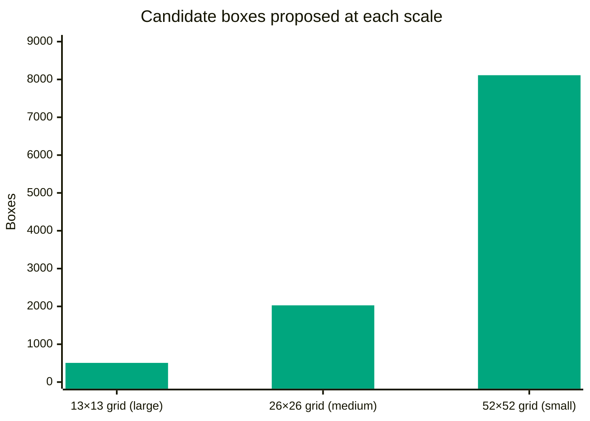
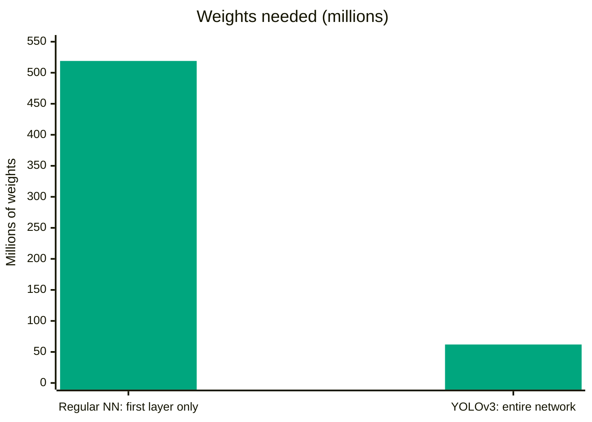
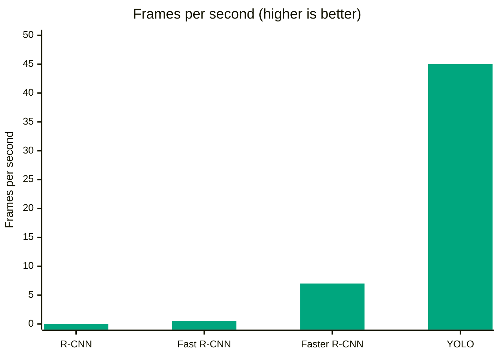

# Argus

**Point it at a street photo or dashcam video. Get every car, bus, pedestrian, and traffic light boxed and labeled.**

Argus is an object detector for driving scenes built on **YOLOv3**, one of the most widely used real-time detection models. It looks at an entire image in a single pass, which makes it fast enough to run frame by frame on video. It recognizes 80 kinds of objects out of the box.


<p align="center">
  
</p>

---

## Demo video

This is Argus running on real street footage. Each frame of the video goes through the network separately, and the boxes are redrawn every frame. That's why they follow the cars as they move.

https://github.com/user-attachments/assets/36151778-992b-45f3-9078-829c6d434b4a

What you're seeing:

- **Box color** = the type of object (each of the 80 classes gets its own color)
- **Label** = the object type and how confident the model is, e.g. `car 0.97` means 97% sure
- **Boxes appearing and disappearing** = the model's confidence crossing the 40% cutoff as objects enter, leave, or get blurry

<p align="center">
  
</p>

<!-- 🎬 FULL-QUALITY VIDEO: on github.com, click ✏️ to edit this README, then drag your
     processed .mp4 onto the empty line below this comment. GitHub uploads it and turns it
     into a playable video player. The file must be under 10 MB. -->


<sub>Generated with `python3 detect.py test_vid.mp4`. The GIF is a shortened, lower-quality preview.</sub>

---

## What it does

| Before | After |
|:---:|:---:|
|  |  |
| A busy city street | Buses, cars, pedestrians and traffic lights, each boxed and scored |


---

## How it works

```
  ┌─────────────────────────────────────────────────────┐
  │  1. Prepare the image                               │
  │     • Resize to 416 × 416, padding with grey so     │
  │       nothing gets stretched                        │
  └───────────────────────┬─────────────────────────────┘
                          │
                          ▼
  ┌─────────────────────────────────────────────────────┐
  │  2. One pass through the neural network (DarkNet)   │
  │     • 106 layers look at the whole image at once    │
  │     • Proposes 10,647 possible boxes                │
  └───────────────────────┬─────────────────────────────┘
                          │
                          ▼
  ┌─────────────────────────────────────────────────────┐
  │  3. Filter the guesses                              │
  │     • Drop boxes it's less than 40% sure about      │
  │     • Non-Maximal Suppression: when boxes overlap   │
  │       on one object, keep only the best one         │
  └───────────────────────┬─────────────────────────────┘
                          │
                          ▼
  ┌─────────────────────────────────────────────────────┐
  │  4. Draw the results                                │
  │     • Colored box + label + confidence per object   │
  └─────────────────────────────────────────────────────┘
```

### Three grids for three object sizes

YOLOv3 splits the image into grids at three sizes, and every grid cell proposes 3 boxes. Coarse grids catch big, nearby objects like the bus in front of you. Fine grids catch small, distant things like traffic lights.

```
  ┌─────┬─────┬─────┐    ┌──┬──┬──┬──┬──┬──┐    ┌┬┬┬┬┬┬┬┬┬┬┬┬┬┬┬┬┐
  │     │█████│     │    ├──┼──┼──┼──┼──┼──┤    ├┼┼┼┼┼┼┼┼┼┼┼┼┼┼┼┼┤
  │     │█████│     │    ├──┼──┼██┼──┼──┼──┤    ├┼┼┼┼┼┼┼┼┼┼┼┼┼█┼┼┤
  ├─────┼─────┼─────┤    ├──┼──┼──┼──┼──┼──┤    ├┼┼┼┼┼┼┼┼┼┼┼┼┼┼┼┼┤
  │     │     │     │    ├──┼──┼──┼──┼──┼──┤    ├┼┼┼┼┼┼┼┼┼┼┼┼┼┼┼┼┤
  └─────┴─────┴─────┘    └──┴──┴──┴──┴──┴──┘    └┴┴┴┴┴┴┴┴┴┴┴┴┴┴┴┴┘
     13 × 13 grid           26 × 26 grid           52 × 52 grid
   big cell → bus         medium → pedestrian    tiny → traffic light
```



---

## Why YOLO is fast

To understand why YOLO matters, compare it with the two simpler kinds of neural network it builds on.

| | Regular neural network | CNN-based detector (R-CNN) | YOLO |
|---|---|---|---|
| **How it sees the image** | Every neuron connects to every single pixel | Small filters slide across the image, reusing the same weights everywhere | Same sliding filters as a CNN |
| **How it finds objects** | It can't. It gives one answer for the whole image, with no location | Cuts the image into ~2,000 candidate regions and runs the CNN on each one | One pass predicts every box and label at once |
| **Network passes per image** | 1, but no boxes | ~2,000 | **1** |
| **Speed** | Not usable for detection | More than 40 seconds per image | **45 frames per second** |

### A regular neural network is far too big

A regular ("fully connected") network wires every input pixel to every neuron. A 416 × 416 color image has 519,168 input values. Connecting those to just 1,000 neurons takes **519 million weights**, and that's only the first layer. A CNN reuses the same small filter everywhere in the image instead, so all 106 layers of YOLOv3 need only **62 million**.



### A plain CNN detector is far too slow

A CNN on its own only answers *"what is in this picture?"* To find *where* things are, older detectors like R-CNN cropped the image into about 2,000 regions and ran the CNN on every crop. YOLO turns detection into a single prediction over the whole image, so it skips all that repeated work.



<sub>Benchmarks from the original YOLO paper (Redmon et al., 2016); YOLO itself was timed on an NVIDIA Titan X. R-CNN is listed as taking "more than 40 seconds per image," shown here as 0.025 FPS. YOLOv3, the version Argus uses, runs in 22–51 ms per image depending on input size and is 3.8× faster than RetinaNet at similar accuracy (Redmon & Farhadi, 2018).</sub>

### Speed in Argus

| Hardware | Time per frame | Frames per second |
|---|:---:|:---:|
| Google Colab, T4 GPU | ~47 ms | ~21 |
| Cloud CPU, no GPU | ~650 ms | ~1.5 |

With a GPU, Argus processes video at close to real time. On a laptop without one it still works, just more slowly.

---

## Tuning the detector

Two settings control what ends up on screen. The animations below come from running Argus on the same photo while sweeping each setting from 0.05 to 0.95. Every frame is a real result, not a mockup.

### `obj_thresh`: how sure the model must be

Every candidate box has a confidence score. `obj_thresh` is the cutoff: anything below it gets thrown away.

<p align="center">
  
</p>

- **Low (0.05):** 47 boxes. It catches every faint pedestrian and traffic light, but also piles on low-confidence guesses: handbags, a backpack, a bicycle, extra trucks.
- **Default (0.40):** 18 boxes. The real objects, with very few mistakes.
- **High (0.95):** 6 boxes. Only the objects it's nearly certain about, so it misses real ones.

### `nms_thresh`: how much boxes may overlap

The network often draws several boxes around the same object. Non-Maximal Suppression keeps the best box and deletes any other box that overlaps it by more than `nms_thresh`.

<p align="center">
  
</p>

- **Low (0.05):** 12 boxes. Too aggressive. Objects close together, like the group of pedestrians and the cars parked behind the silver SUV, lose their boxes because they overlap a neighbor.
- **Default (0.45):** 18 boxes. One box per object.
- **High (0.95):** 46 boxes. Almost nothing gets removed, so every object is buried in duplicate boxes.

<details>
<summary><b>Still images</b> (low · default · high)</summary>
<br>


</details>

---

## Features

- **Photos and videos.** Pass in a `.jpg` or `.mp4` and it figures out which one it is
- **80 object types** from the COCO dataset: cars, trucks, buses, people, bikes, traffic lights, stop signs and more
- **Live progress** for videos (`Processing frame 126/396 (32%)`)
- **Adjustable thresholds** from the command line or the browser demo
- **Browser demo** with drag-and-drop upload and sliders
- **No model setup.** The 250 MB trained weights download automatically the first time

---

## Getting started

### Prerequisites
- [Python](https://www.python.org/downloads/) 3.10 or later

### Setup

```bash
# 1. Clone the repo
git clone https://github.com/chiragmenonr/Argus.git
cd Argus

# 2. Install dependencies
pip3 install -r requirements.txt
```

> **Mac users:** if you see `CERTIFICATE_VERIFY_FAILED` on the first run, double-click
> **Applications → Python 3.x → Install Certificates.command**, then try again.

### Option 1: Command line

```bash
python3 detect.py street.jpg                    # → street_detected.jpg
python3 detect.py dashcam.mp4                   # → dashcam_detected.mp4
python3 detect.py street.jpg --obj-thresh 0.6   # stricter detection
```

### Option 2: Browser demo


This starts a small web page on your own computer. Open **http://localhost:7860** in any browser, drag in a photo, adjust the two sliders, and click **Submit**. The labeled image appears on the right. You can try different settings without retyping commands. Press `Ctrl + C` in the terminal to shut it down.

<p align="center">
  <p align="center"></p>
</p>

---

## Tech stack

| Layer | Technology |
|---|---|
| Model | YOLOv3 (DarkNet-53), pre-trained on COCO |
| Deep learning | TensorFlow / Keras |
| Image & video | OpenCV, Pillow |
| Browser demo | Gradio |

---

## Project structure

```
detect.py          — command-line entry point: image or video in, labeled file out
app.py             — browser demo with upload + threshold sliders
yolo_helpers.py    — the pipeline: preprocess → decode → NMS → draw
requirements.txt   — Python dependencies
assets/            — images and GIFs used in this README
models/            — trained weights, downloaded on first run (not in git)
```

---

## Credits

- Redmon, Divvala, Girshick & Farhadi, [*You Only Look Once: Unified, Real-Time Object Detection*](https://arxiv.org/abs/1506.02640) (2016): speed benchmarks
- Redmon & Farhadi, [*YOLOv3: An Incremental Improvement*](https://arxiv.org/abs/1804.02767) (2018): the model architecture
- Pre-trained on the [COCO dataset](https://cocodataset.org/)
- Built from the Inspirit AI *Object Detection for Autonomous Driving* project, which also provided the weights file and sample footage
