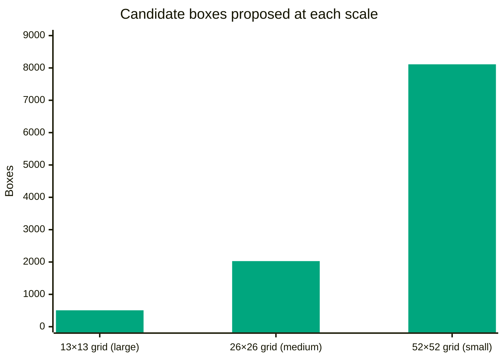

# Argus

**Point it at a photo or dashcam video. Get every car, pedestrian, and traffic light boxed and labeled.**

Argus is an object detector for driving scenes built on **YOLOv3**, one of the most widely used real-time detection models. It looks at a whole image in a single pass, so it's fast enough to run frame-by-frame on video, and it recognizes 80 kinds of objects out of the box.

<p align="center">
  
</p>

<!-- 🎬 FULL-QUALITY VIDEO (optional): on github.com, click ✏️ to edit this README,
     then drag test_vid_detected.mp4 onto this line. GitHub turns it into a playable
     video. The file must be under 10 MB. -->

---

## What it does

| Before | After |
|:---:|:---:|
|  |  |
| A dark, rainy street at night | The car and both traffic lights found |

Each box shows **what** the object is and **how confident** the model is: `car 0.97` means 97% sure.

---

## How it works

```
  ┌─────────────────────────────────────────────────────┐
  │  1. Prepare the image                               │
  │     • Resize to 416 × 416, padding with grey so     │
  │       nothing gets stretched                        │
  └───────────────────────┬─────────────────────────────┘
                          │
                          ▼
  ┌─────────────────────────────────────────────────────┐
  │  2. One pass through the neural network (DarkNet)   │
  │     • 106 layers look at the whole image at once    │
  │     • Proposes 10,647 possible boxes                │
  └───────────────────────┬─────────────────────────────┘
                          │
                          ▼
  ┌─────────────────────────────────────────────────────┐
  │  3. Filter out the guesses                          │
  │     • Drop boxes it's less than 40% sure about      │
  │     • Non-Maximal Suppression: when boxes overlap   │
  │       on one object, keep only the best one         │
  └───────────────────────┬─────────────────────────────┘
                          │
                          ▼
  ┌─────────────────────────────────────────────────────┐
  │  4. Draw the results                                │
  │     • Colored box + label + confidence per object   │
  └─────────────────────────────────────────────────────┘
```

### Three grids for three object sizes

YOLOv3 splits the image into grids at three sizes and every cell proposes 3 boxes. Coarse grids catch big, nearby cars. Fine grids catch small, distant traffic lights.

```
   13 × 13 grid            26 × 26 grid            52 × 52 grid
  ┌─────┬─────┬─────┐    ┌──┬──┬──┬──┬──┬──┐    ┌┬┬┬┬┬┬┬┬┬┬┬┬┬┬┬┬┐
  │     │█████│     │    ├──┼──┼──┼──┼──┼──┤    ├┼┼┼┼┼┼┼┼┼┼┼┼┼┼┼┼┤
  │     │█████│     │    ├──┼──┼██┼──┼──┼──┤    ├┼┼┼┼┼┼┼┼┼┼┼┼┼█┼┼┤
  ├─────┼─────┼─────┤    ├──┼──┼──┼──┼──┼──┤    ├┼┼┼┼┼┼┼┼┼┼┼┼┼┼┼┼┤
  │     │     │     │    ├──┼──┼──┼──┼──┼──┤    ├┼┼┼┼┼┼┼┼┼┼┼┼┼┼┼┼┤
  └─────┴─────┴─────┘    └──┴──┴──┴──┴──┴──┘    └┴┴┴┴┴┴┴┴┴┴┴┴┴┴┴┴┘
   big cell → nearby car  medium → pedestrian    tiny → traffic light
```



---

## Features

- **Photos and videos.** Pass in a `.jpg` or `.mp4` and it figures out which one it is
- **80 object types** from the COCO dataset: cars, trucks, buses, people, bikes, traffic lights, stop signs and more
- **Live progress bar** for videos (`Processing frame 126/396 (32%)`)
- **Adjustable sensitivity** to trade more detections for fewer mistakes
- **Browser demo.** Upload an image and move sliders, no terminal needed
- **No setup for the model.** The 250 MB trained weights download automatically the first time

---

## Getting started

### Prerequisites
- [Python](https://www.python.org/downloads/) 3.10 or later

### Setup

```bash
# 1. Clone the repo
git clone https://github.com/chiragmenonr/Argus.git
cd Argus

# 2. Install dependencies
pip3 install -r requirements.txt

# 3. Run it on a photo or video
python3 detect.py street.jpg      # → street_detected.jpg
python3 detect.py dashcam.mp4     # → dashcam_detected.mp4

# 4. (Optional) Start the browser demo
python3 app.py                    # → open http://localhost:7860
```

> **Mac users:** if you see `CERTIFICATE_VERIFY_FAILED` on the first run, double-click
> **Applications → Python 3.x → Install Certificates.command**, then try again.

### Tuning

| Option | Default | Higher | Lower |
|---|:---:|---|---|
| `--obj-thresh` | `0.4` | Only confident detections | Catches more, more mistakes |
| `--nms-thresh` | `0.45` | Allows more overlapping boxes | Merges nearby boxes |

```bash
python3 detect.py street.jpg --obj-thresh 0.6
```

---

## Tech stack

| Layer | Technology |
|---|---|
| Model | YOLOv3 (DarkNet-53), pre-trained on COCO |
| Deep learning | TensorFlow / Keras |
| Image & video | OpenCV, Pillow |
| Web demo | Gradio |

---

## Project structure

```
detect.py          — command-line entry point: image or video in, labeled file out
app.py             — browser demo with upload + threshold sliders
yolo_helpers.py    — the pipeline: preprocess → decode → NMS → draw
requirements.txt   — Python dependencies
assets/            — images and GIF used in this README
models/            — trained weights, downloaded on first run (not in git)
```

---

## Credits

- Redmon & Farhadi, [*YOLOv3: An Incremental Improvement*](https://arxiv.org/abs/1804.02767) (2018)
- Trained on the [COCO dataset](https://cocodataset.org/)
- Built from the Inspirit AI *Object Detection for Autonomous Driving* project
